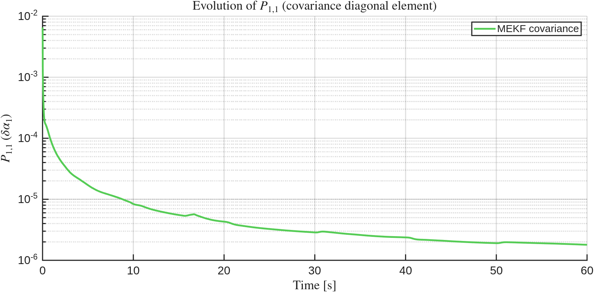
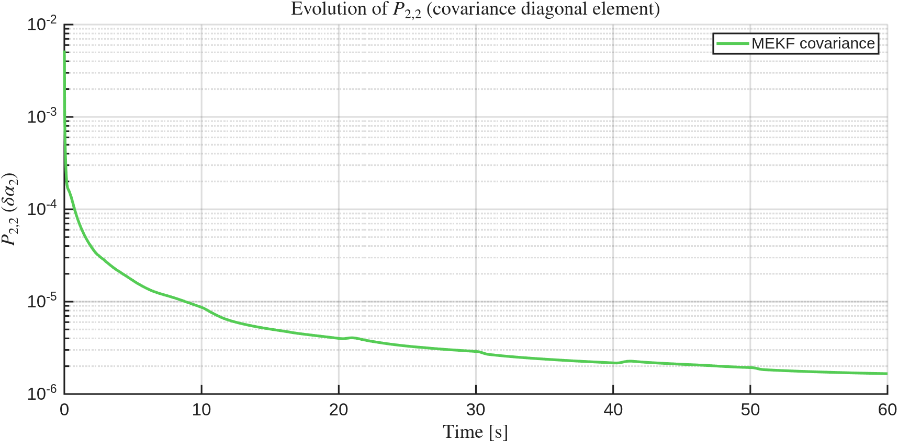
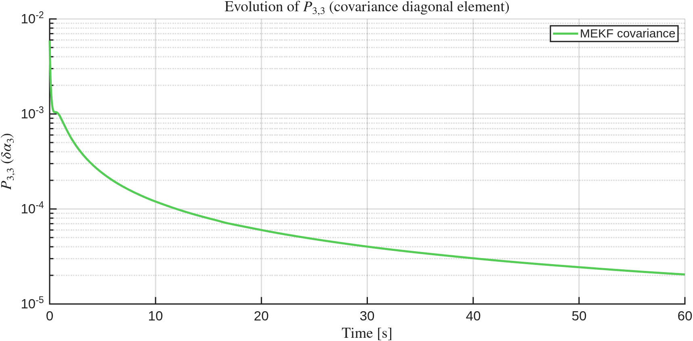
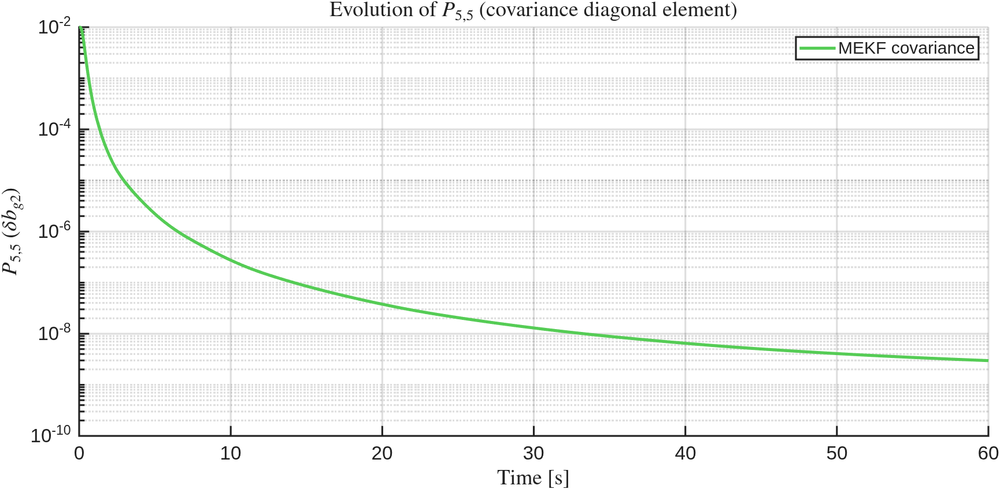
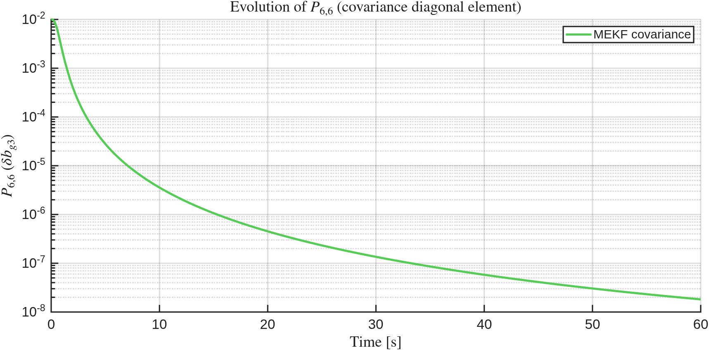
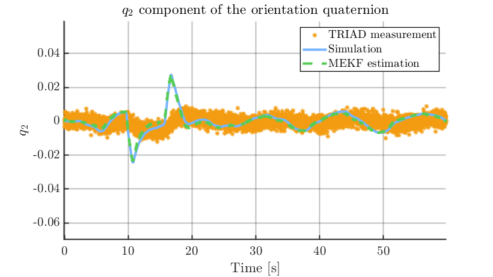
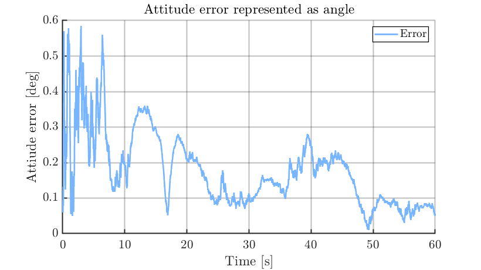

# Multicopter Attitude Estimation using MEKF

## Overview

This repository presents a MATLAB implementation of a **Multiplicative Extended Kalman Filter (MEKF)** for multicopter attitude estimation.

The objective of this project is to demonstrate a solid understanding of:

* Nonlinear state estimation
* Sensor fusion using IMU data
* Error-state Kalman filtering
* Rigid body orientation representation using quaternions

---

## Problem Description

In low-cost inertial navigation systems, the orientation of a rigid body cannot be measured directly with sufficient accuracy.

* Gyroscopes provide high-frequency angular velocity measurements but suffer from **bias and drift**.
* Accelerometers and magnetometers provide **absolute references**, but are noisy and sensitive to disturbances.

The goal is to combine these measurements to obtain a robust and consistent estimate of the system attitude.

---

## Approach

The estimation problem is addressed using a **Multiplicative Extended Kalman Filter (MEKF)** in an **error-state formulation**.

Key features of the approach:

* Attitude represented using **unit quaternions**
* Gyroscope bias included in the state vector
* Error modeled in a **minimal representation (3D)**
* Multiplicative correction to preserve quaternion structure
* Continuous-time model with discrete-time implementation

---

## Simulation

The filter is validated in simulation using:

* Ground truth from a multicopter dynamic model
* Noisy IMU and magnetometer measurements
* Comparison against:

  * True attitude
  * TRIAD algorithm

### Results:

* Attitude estimation error remains below **1 degree**
* Drift from gyroscope integration is effectively corrected
* High-frequency noise remains (as expected)

---

## Repository Structure

```
├── src/           # MATLAB implementation
├── simulations/   # Test scenarios and scripts
└── results/       # Plots and evaluation
```
---

## How to run

**Requirements:** MATLAB and Aeroespace Toolbox.

```matlab
% 1. Clone the repository
% git clone https://github.com/tomisuarez2/mekf-att-est.git

% 2. Run the main simulation
run('simulations/mekf.m');
```

---

## Design decisions

- **Why *error-state* and not an EKF over the complete quaternion:** the quaternion has 4 components but only 3 degrees of freedom. Estimating the error with 3 parameters avoids a singular covariance of 4x4 and works in an area where linealization is very good (the error is small and centered at zero).
- **Why the multiplicative correction:** maintains the restriction of unit standard per construction.
- **Why estimate bias:** A constant bias integrated into the gyroscope produces linear drift in the attitude; including it in the state allows the filter to observe it through gravity and magnetic field references.
- **Why compare against TRIAD:** TRIAD uses only vector measurements of each instant, without dynamics or memory. Serves as a baseline for quantifying what fusion brings to the gyroscope and noise model.
- **How covariance is interpreted:** `P` is used as a diagnostic tool, not just as an intermediate step.

---

## Results

<div align="center">
  
</div>

<div align="center">
  
</div>

<div align="center">
  
</div>

<div align="center">
  
</div>

<div align="center">
  
</div>

<div align="center">
  
</div>

<div align="center">
  
</div>

<div align="center">
  
</div>

<div align="center">
  
</div>

<div align="center">
  
</div>

<div align="center">
  
</div>

<div align="center">
  
</div>

<div align="center">
  
</div>

<div align="center">
  
</div>


```matlab
>>> Estimation Performance:
    - Mean attitude error: 0.5175 deg
    - Max attitude error: 3.4381 deg
    - RMS attitude error: 0.6854 deg
```
---

## References

* Crassidis & Junkins — *Optimal Estimation of Dynamic Systems*

---

## Key Takeaways

This project demonstrates:

* Practical implementation of Kalman filtering
* Sensor fusion for real-world systems

---

## Future Work

* Real sensor data validation
* Adaptive noise tuning
* Integration with control loops
* Implementation in C++ / embedded systems

---

## Contact

If you have questions or want to collaborate, feel free to reach out:
**Tomás Suárez**
Mechatronics Engineering Student
📧 [suareztomasm@gmail.com](mailto:suareztomasm@gmail.com)

