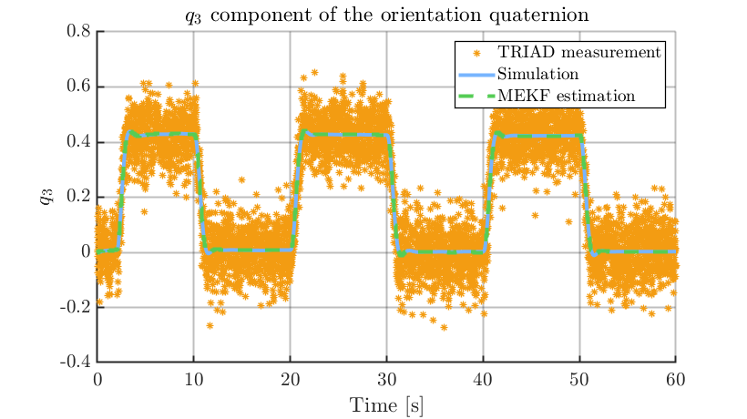
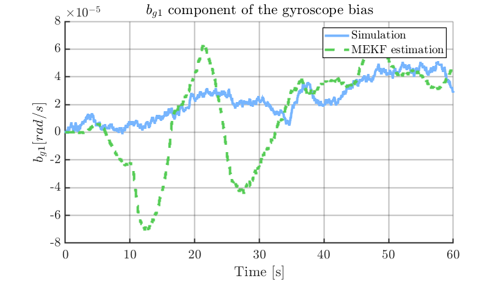
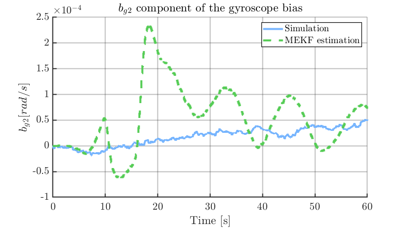

# Multicopter Attitude Estimation using MEKF

## 📌 Overview

This repository presents the modeling, derivation, and MATLAB implementation of a **Multiplicative Extended Kalman Filter (MEKF)** for multicopter attitude estimation.

The objective of this project is to demonstrate a solid understanding of:

* Nonlinear state estimation
* Sensor fusion using IMU data
* Error-state Kalman filtering
* Rigid body orientation representation using quaternions

The work is based on a full theoretical development, followed by a simulation-based validation.

---

## 🧠 Problem Description

In low-cost inertial navigation systems, the orientation of a rigid body cannot be measured directly with sufficient accuracy.

* Gyroscopes provide high-frequency angular velocity measurements but suffer from **bias and drift**.
* Accelerometers and magnetometers provide **absolute references**, but are noisy and sensitive to disturbances.

The goal is to combine these measurements to obtain a robust and consistent estimate of the system attitude.

---

## ⚙️ Approach

The estimation problem is addressed using a **Multiplicative Extended Kalman Filter (MEKF)** in an **error-state formulation**.

Key features of the approach:

* Attitude represented using **unit quaternions**
* Gyroscope bias included in the state vector
* Error modeled in a **minimal representation (3D)**
* Multiplicative correction to preserve quaternion structure
* Continuous-time model with discrete-time implementation

---

## 🧪 Simulation

The filter is validated in simulation using:

* Ground truth from a multicopter dynamic model
* Noisy IMU and magnetometer measurements
* Comparison against:

  * True attitude
  * TRIAD algorithm

### Results:

* Attitude estimation error remains below **1 degree**
* Drift from gyroscope integration is effectively corrected
* High-frequency noise remains (as expected)

---

## 📂 Repository Structure

```
├── src/           # MATLAB implementation
├── simulations/   # Test scenarios and scripts
├── theory/        # Theoretical derivation (PDF, in Spanish)
└── results/       # Plots and evaluation
```
---

## 📊 Results

<div align="center">
  
</div>

<div align="center">
  
</div>

<div align="center">
  
</div>

<div align="center">
  
</div>

<div align="center">
  
</div>

<div align="center">
  
</div>

<div align="center">
  
</div>

<div align="center">
  
</div>

```bash
>>> Estimation Performance:
    - Mean attitude error: 0.1769 deg
    - Max attitude error: 0.5855 deg
    - RMS attitude error: 0.2038 deg
```
---

## 📚 References

* Crassidis & Junkins — *Optimal Estimation of Dynamic Systems*
* Markley — *Attitude Error Representations for Kalman Filtering*
* Shuster — *Three-Axis Attitude Determination*
* Quan — *Multicopter Design and Control*

---

## 🚀 Key Takeaways

This project demonstrates:

* Ability to derive a nonlinear estimator from first principles
* Understanding of estimation on manifolds (SO(3))
* Practical implementation of Kalman filtering
* Sensor fusion for real-world systems

---

## 🛠️ Future Work

* Real sensor data validation
* Adaptive noise tuning
* Integration with control loops
* Implementation in C++ / embedded systems

---

## 🛰️ Contact

If you have questions or want to collaborate, feel free to reach out:
**Tomás Suárez**
Mechatronics Engineering Student
📧 [suareztomasm@gmail.com](mailto:suareztomasm@gmail.com)

